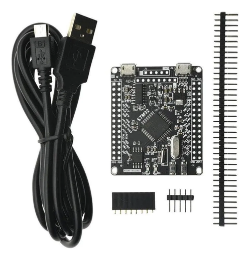
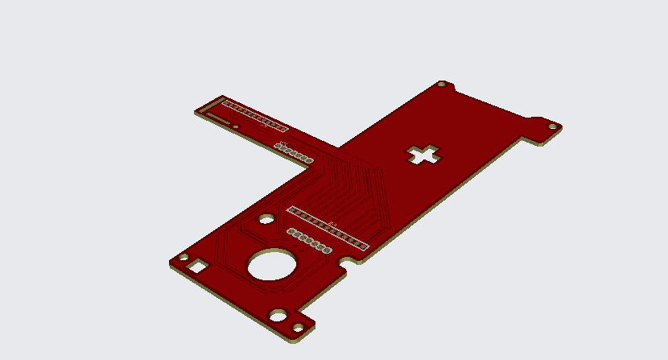
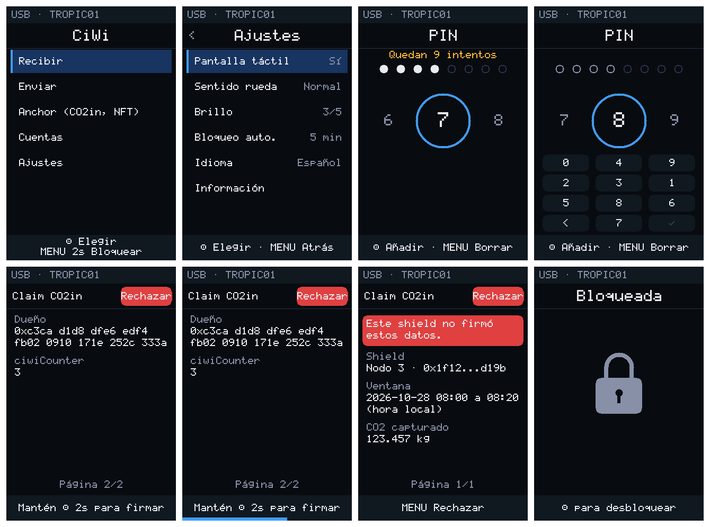

# software-ciwi

Test firmware for the **CiWi** cold wallet (WALCORG) on an **STM32F405RGT6** board (WeAct STM32F4 64-pin Core Board architecture),
based on a fork of the Trezor firmware. Version 0.2 made the original draft build and boot on the
board. Version 0.3 added phase 7: the TROPIC01 secure element and the
[Anchor Protocol](https://github.com/walcorg/anchor-protocol) (see [below](#phase-7-tropic01-and-the-anchor-protocol)).
Version 0.4 added phase 8: the CiWi interface (portrait screen, click-wheel navigation, hold to
sign, optional touch; see [below](#phase-8-the-ciwi-interface)). **Version 0.5 makes the PIN guard
the signing key**: without the right PIN the STM32 holds nothing that can sign
(see [`SECURITY.md`](SECURITY.md)).
Full list of changes: [`CHANGES.md`](CHANGES.md).

All 8 phases and the LED test build with `arm-none-eabi-gcc 13.2`. Prebuilt binaries are in `dist/`.

## Hardware path

The CiWi board is designed in Autodesk Fusion using the **WeAct STM32F4 64-pin Core Board V1.1**
as its reference design ([schematic](docs/hardware/WeAct-STM32F4_64PIN-CoreBoard_V11_Schematic.pdf),
© WeAct Studio, included for reference). Development follows three steps:

1. **Test board (now):** an STM32F405RGT6 development board with the same core architecture as the
   WeAct reference, plus an extra USB port that makes flashing easier. This firmware is tested here first.
2. **Intermediate step:** a PCB that **keeps the WeAct core architecture unchanged** (STM32F405RGT6,
   8 MHz HSE, LED on PB2, KEY on PC13, USB on PA11/PA12, SWD and UART headers) but already has the
   **CiWi form factor**: outline, mounting holes, display header and the click-wheel opening.
   Code that passes on the test board should run on it without pin changes.
3. **CiWi main board:** the final design, adding the TROPIC01 secure element and the CiWi peripherals.

| Test board | Intermediate step: WeAct architecture in the CiWi form factor |
| --- | --- |
|  |  |

## What you need

| Item | Purpose |
| --- | --- |
| STM32F405RGT6 test board (WeAct STM32F4 64-pin Core Board V1.1 architecture) | 8 MHz HSE crystal, user LED on **PB2**, KEY button on PC13 |
| ST-Link V2 (or clone) | Flashing and debugging over SWD (DIO, CLK, GND, 3V3) |
| 3.3 V USB-UART adapter | Test output: **PA9 (TX) → adapter RX**, common GND, 115200 8N1 |
| USB-C cable | USB tests (phases 1 and 5) |
| 3.5" ILI9488 SPI display with XPT2046 | Phases 2 to 6 (pins below) |
| TROPIC01 (Tropic Square) on a breakout or the shield | Phase 7, on SPI2 (pins below) |
| `arm-none-eabi-gcc`, `make`, `openocd`, `git` | Build and flash (Ubuntu: `sudo apt install gcc-arm-none-eabi make openocd git`) |

## Flash a prebuilt binary (fastest)

```bash
openocd -f tools/openocd_weact_f405.cfg -c "program dist/ciwi-blink.elf verify reset exit"
openocd -f tools/openocd_weact_f405.cfg -c "program dist/ciwi-phase1.elf verify reset exit"
openocd -f tools/openocd_weact_f405.cfg -c "program dist/ciwi-phase7.elf verify reset exit"
```

Open a serial terminal (for example `picocom -b 115200 /dev/ttyUSB0`) before resetting the board.

## Build

```bash
./tools/fetch_vendor.sh      # downloads ST HAL, CMSIS and trezor-crypto (pinned commits)
make blink                   # minimal LED test
make PHASE=1                 # or 2..8 → build/phaseN/ciwi-phaseN.{elf,bin,hex}
make flash PHASE=1           # build and flash with OpenOCD
make flash-blink
make erase-storage           # dev board only: erases NORCOW (PIN, seed, TROPIC01 pairing key)
```

`LAYOUT=standalone` (default) places the firmware at **0x08000000** so the board boots without a
bootloader. `LAYOUT=bootloader` places it at 0x08010000 for when a bootloader exists.

## Test plan, one phase at a time

Do not move to the next phase until the current one passes.

| Step | Binary | Connect | Pass criteria |
| --- | --- | --- | --- |
| 0 | `ciwi-blink` | ST-Link only | Blue LED (PB2) blinks |
| 1 | `ciwi-phase1` | + USB-UART on PA9 and USB-C | Terminal shows 168 MHz clock, LED, UART and RNG **OK**; the PC detects a USB device. The click-wheel test reports **WARN** (it looks for an AS5600, see notes) |
| 2 | `ciwi-phase2` | + ILI9488 display | Colors, text and test patterns on screen |
| 3 | `ciwi-phase3` | + display | Navigable menu (test inputs) |
| 4 | `ciwi-phase4` | + display | UI screens, backlight and animations |
| 5 | `ciwi-phase5` | + display + USB-C | BIP39/BIP32/ECDSA vectors OK over UART; `trezorctl get-features` responds. **Test seeds and testnet only** |
| 6 | `ciwi-phase6` | + display + USB-C | Full security audit report over UART. RDP is **not** applied automatically; do not enable it on the dev board |
| 7 | `ciwi-phase7` | + TROPIC01 on SPI2 (no display needed) | Every line **PASS** on the UART; the printed vectors pass `tests/host/verify.js`. First run: hold KEY 3 s to provision |
| 8 | `ciwi-phase8` | + display (portrait) + TROPIC01 | New PIN on the first boot, then the menus; a signature is approved only by holding KEY 2 s. Without TROPIC01 it runs in DEMO mode |

### Pins

Pin assignments follow the [WeAct STM32F4 64-pin Core Board V1.1 schematic](docs/hardware/WeAct-STM32F4_64PIN-CoreBoard_V11_Schematic.pdf). If the LED does not blink
on a different test board, check which pin its LED uses and adjust `LED_PIN` in `blink_test.c`.

| Function | Pin |
| --- | --- |
| User LED | PB2 |
| Debug UART TX | PA9 (USART1) |
| USB FS | PA11 / PA12 |
| Display SPI1 | PA5 SCK, PA7 MOSI, PA6 MISO, PC4 CS, PC5 DC, PB0 RST, PB1 BL |
| Touch XPT2046 | PC6 CS, **PC7 IRQ [to verify]** (shares SPI1) |
| Click-wheel (I2C) | PB6 SCL / PB7 SDA |
| TROPIC01 (SPI2) | PB13 SCK, PB14 MISO, PB15 MOSI, PB12 CSN, PB10 GPO (optional) |
| KEY button | PC13 (pressed = high); confirms signatures in phase 7 |

## Layout

| Folder | Contents |
| --- | --- |
| `platform/` | Startup, linker scripts, clock, UART, interrupts, HAL configuration |
| `drivers/` | ILI9488 display, touch, backlight, click-wheel, compatibility layer for Trezor's display API |
| `ui/` | Input, menu, components and screens |
| `wallet/` | Crypto test vectors, NORCOW storage, USB HID, wallet core, FSM, signing |
| `security/` | Flash protection, MPU, PIN delay, tamper detection, security audit |
| `tropic/` | TROPIC01: session, provisioning, anchor key, counter, MAC-and-Destroy PIN, STM32 port (SPI2) |
| `anchor/` | Anchor Protocol v0.2: EIP-712 hashing, shield signature checks, CiWi signatures, self-test |
| `ciwi_ui/` | The CiWi interface: screens, navigation, PIN, signing confirmation, Settings, input events, drawing (portable) |
| `tests/host/` | Runs `tropic/` and `anchor/` on a PC against the TROPIC01 model, then checks the vectors with ethers.js |
| `tests/ui/` | Runs `ciwi_ui/` on a PC with scripted input; checks and screenshots |
| `phases/phaseN/` | Test program for each phase |
| `trezor-integration/` | Files that **replace** Trezor legacy files (`protect.c`, `buttons.c`, `layout.c`...). Not built here; kept for integration with the Trezor tree |
| `tools/` | OpenOCD config, gdbinit, `fetch_vendor.sh` |
| `dist/` | Prebuilt binaries and SHA-256 checksums |
| `docs/hardware/` | Reference schematic of the WeAct STM32F4 64-pin Core Board V1.1 (© WeAct Studio) |
| `docs/original-notes/` | Original Makefiles and notes, for reference |

Source-code comments from the original draft are mostly in Spanish; new code (phase 7, `tropic/`, `anchor/`, `tests/`) is in English.

## Known open items (they do not block testing)

- **VID:PID 1209:53C1 belongs to Trezor.** It is convenient for testing with `trezorctl`, but a dedicated
  PID must be requested from pid.codes before any unit leaves the workshop.
- **Click-wheel:** the driver targets the AS5600 magnetic sensor; the CiWi now uses a capacitive wheel.
- **Touch:** `touch_xpt2046.h` was reconstructed because it was missing; the IRQ pin (PC7) is an assumption.
- **TROPIC01 on hardware:** phase 7 passes against the TROPIC01 model, not yet on a real chip; the
  SPI2 port and the wiring are the parts still to prove on the bench.
- **Security:** see [`SECURITY.md`](SECURITY.md) for the threat model and open items.
- **Wallet integration:** phases 5 and 6 still keep the PIN with PBKDF2 in the STM32 flash. Moving the
  wallet to the MAC-and-Destroy PIN (`tropic/tr01_pin.h`) and wrapping the seed with its key is the next step.
- **Anchor Protocol:** messages are hashed, checked, confirmed on screen and signed; the USB messages
  (`proto/anchor.proto`) and Polygon transaction signing are not implemented yet.
- **Click-wheel:** the capacitive wheel driver waits for the sensor choice; the wheel and MENU are
  emulated from the UART in phase 8. Receive, Send and Accounts are placeholders.
- **Touch orientation:** the XPT2046 driver reports landscape coordinates; phase 8 rotates them for
  portrait. If taps land mirrored, build with `EXTRA_DEFS="-DCIWI_TOUCH_FLIP_X=1"` (or `_Y`).
- **License:** source files are GPL v3, like `trezor-firmware`. trezor-crypto (`vendor/`) is MIT.

## Phase 7: TROPIC01 and the Anchor Protocol

Phase 7 runs on the phase 1 setup plus a TROPIC01 wired to SPI2. It uses
[libtropic](https://github.com/tropicsquare/libtropic) v4.2.0 (Tropic Square, Clear BSD) with the
trezor-crypto backend, so no second crypto library is added.

| TROPIC01 resource | CiWi use |
| --- | --- |
| Pairing key slot 0 (SH0) | Factory key, used once at the bench to provision slots 1 and 2 |
| Pairing key slot 1 (SH1) | Signing key: the only session that may use the anchor key and the counter. Stored **encrypted with the PIN key** |
| Pairing key slot 2 (SH2) | Boot key: its session can only check the PIN |
| ECC key slot 0 | P-256 **anchor key**, generated inside the chip; signs Claim, Bind and NftClaim |
| Monotonic counter 0 | `ciwiCounter` of the Claim messages |
| MAC-and-Destroy slots 0-9, user data slot 511 | PIN with 10 attempts, bound to the STM32 unique ID |

**First run.** The UART shows `Not provisioned`. Hold KEY for 3 s. The firmware opens a session with
the factory key, writes a boot key (slot 2) and a signing key (slot 1), both TROPIC01 TRNG XOR STM32
RNG, writes the CiWi access policy, sets the **test PIN 2468** with MAC-and-Destroy, stores the signing
key encrypted with the PIN key, generates the anchor key and initialises the counter. It prints the
anchor public key and the `ciwiId` (`keccak256(curve ‖ X ‖ Y)`), which are what gets registered on
walcorg.com. Phase 8 provisions with the owner's PIN instead.

**Then, on every boot:** boot session (LOCKED), unlock with the test PIN, ping, random numbers, a
signature, a wrong PIN and the right one, and the Anchor self-test. The self-test uses a **test shield key compiled into the firmware** (a real shield
signs inside its own TROPIC01): the CiWi verifies a CaptureReceipt, a Bind and an NFT WindowRecord,
waits for a KEY press for each one, and signs with TROPIC01. All signatures are low-s and are verified
before they leave the chip driver.

**Check the board's output on a PC.** Copy the block between `-----BEGIN CIWI ANCHOR VECTORS-----` and
`-----END CIWI ANCHOR VECTORS-----` to `tests/host/vectors.json`, then:

```bash
cd tests/host && npm install && node verify.js vectors.json
```

`verify.js` recomputes every EIP-712 digest with ethers.js and checks every signature with
@noble/curves, independently of the C code.

**Build options** (`make PHASE=7 EXTRA_DEFS="-D..."`, after `make clean`):

| Option | Default | Effect |
| --- | --- | --- |
| `-DCIWI_TR01_SH0_ENG_SAMPLE=1` | 0 | Engineering-sample chip (different factory key) |
| `-DCIWI_TR01_APPLY_RCONFIG=0` | 1 | Do not write the CiWi access policy (development only: then any session can sign and the PIN does not protect the anchor key) |
| `-DCIWI_TR01_INVALIDATE_SH0=1` | 0 | **Irreversible.** Disables the factory key. Not needed for the policy; never on a dev board |

### Test without hardware

`tests/host` compiles the same `tropic/` and `anchor/` sources for a PC and runs them against the
TROPIC01 model ([ts-tvl](https://github.com/tropicsquare/ts-tvl)):

```bash
pip install https://github.com/tropicsquare/ts-tvl/releases/download/2.7/tvl-2.7-py3-none-any.whl
./tools/fetch_vendor.sh
cd tests/host && npm install && make test     # make test-no-policy: without the access policy
```

Current result on the model: `make test` 63/63 and 16/16 in `verify.js`. It covers provisioning,
LOCKED until the PIN, signatures and counter, the access policy enforced by the chip (neither the
factory key nor the boot key can sign, move the counter, erase the anchor key or rewrite the policy),
PIN change keeping the same anchor key, a damaged or foreign key record, and the lock-out after 10
wrong PINs.

## Phase 8: the CiWi interface



Phase 8 runs the interface from the specification: portrait 320×480, four fixed zones (status,
title, content, help), menus driven by the wheel, the centre button and MENU, and an optional touch
screen that can be turned off in Settings.

| Control | Action |
| --- | --- |
| Wheel | Move through lists, pages and PIN digits |
| Centre, click | Select |
| Centre, held 2 s | Approve a signature (only on the last page, only the physical button) |
| MENU, click | Back, or reject a signature |
| MENU, held 2 s | Home; on Home, lock |
| Touch | Select, scroll, reject; never approve |

**On the development board** the centre button is KEY (PC13). The wheel and MENU are emulated from
the serial terminal: `a`/`d` wheel, `e` centre click, `m` MENU, `h` MENU held. Emulated input can
navigate and reject but cannot approve: only KEY held 2 s signs.

With a new TROPIC01 the first boot asks the owner for a PIN (twice) and provisions the chip with it;
later boots start LOCKED and ask for it (10 attempts, counted by TROPIC01). Settings > Change PIN
keeps the same anchor key. Anchor > Test signatures runs the phase 7 self-test with the
confirmation screens and prints the vectors on the UART. Without a TROPIC01 the interface runs in DEMO
mode. Settings are stored in NORCOW.

### Test the interface without hardware

```bash
cd tests/ui && make test      # needs Pillow for the screenshots (pip install pillow)
```

The interface code is compiled for a PC, driven by a script (wheel turns, clicks, holds, taps) on a
simulated clock, and checked: 16 checks, including that touch and emulated input can never approve,
that a hold released at 1 s does not sign, that invalid shield data can only be rejected, and that
auto-lock rejects a pending signature. Screenshots of every screen go to `tests/ui/shots/`.

## Third-party software

trezor-crypto (MIT), STM32CubeF4 HAL and CMSIS (BSD-3-Clause / Apache-2.0) and libtropic (Clear BSD,
© Tropic Square s.r.o.). Notices for the binaries: [`dist/THIRD-PARTY-NOTICES.txt`](dist/THIRD-PARTY-NOTICES.txt).
